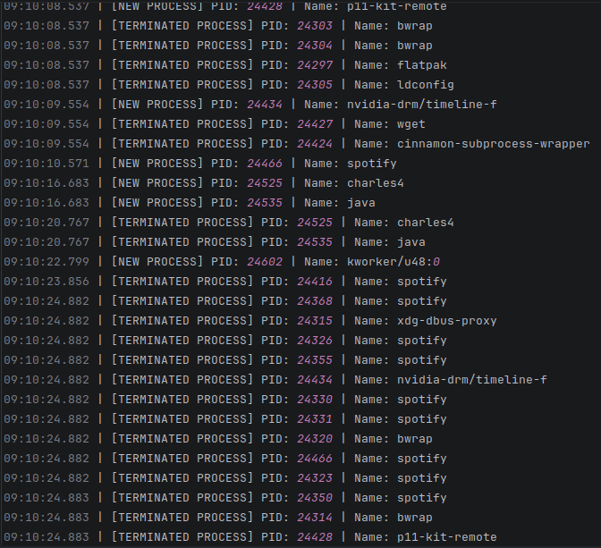
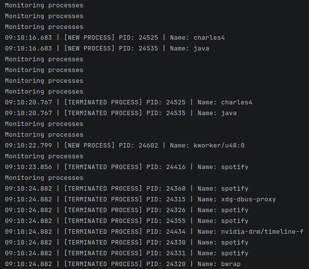

# Endpoint Detector

## About

Endpoint Detector is a Python script I've been working on that monitors running processes and logs their activity to a file.

It works on Windows, macOS, and Linux. The idea behind the project is to provide a simple way to keep track of processes running on a system.

## Features

- Monitors running processes
- Logs process activity to a local file
- Works on Windows, macOS, and Linux
- Runs continuously until stopped

## Requirements

- Python 3
- Required Python libraries (if not already installed)

## Usage

1. Download or clone the repository.
2. Install any required dependencies.
3. Run the Python script.
4. The script will start monitoring processes and saving logs in the same directory as the script.

## How It Works

Once started, the script checks the processes running on the system and records their activity in a log file.

These logs can then be viewed to see what processes have been running.

## Examaple Output

Below is an example of the process logs generated by the script and the terminal output.

### Process Event Logs

### Terminal Output

## Development

This is still a work in progress. I'm planning to continue improving the script and adding more functionality as I work on it.
I am planning on implementing 